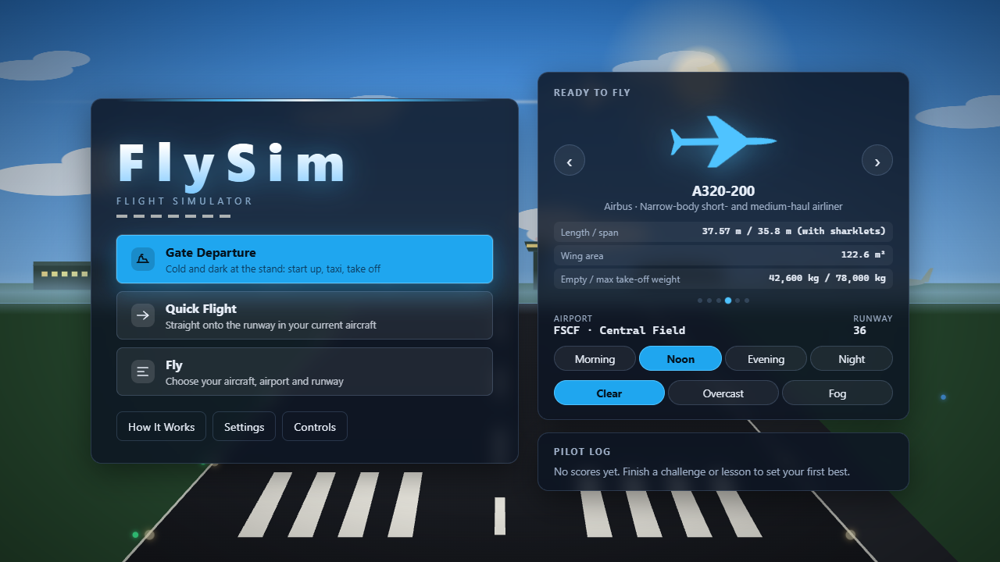

<div align="center">

# ✈️ FlySim

**A flight simulator that runs in your browser.**

Start cold and dark at the gate, push back, taxi, take off, fly and land, from a light trainer to an A350.

[](LICENSE)
[](CONTRIBUTING.md)
[](https://react.dev)
[](https://threejs.org)
[](https://www.typescriptlang.org)



</div>

## Features

- **Flight physics:** lift, drag, thrust, ground handling and wind (gusts, crosswind) for each aircraft, including landing on open ground
- **Six aircraft:** FS-1 Trainer, Airbus A220, Airbus A320, Airbus A350, Bombardier Global 8000 and F-22, each tuned against published figures. The airliners, the business jet and the F-22 are drawn from detailed 3D models (the A320 and A220 have working, retracting landing gear; the A220 has a livery)
- **Gate departure:** start cold and dark at the stand, refuel and board through a working jet bridge, stay within weight and balance limits, push back (`T`), start the engines, taxi with ATC and a checklist, and take off
- **Gate arrival:** land, vacate the runway, taxi in, park on the stand and deplane
- **Busy airports:** glass terminals with finger piers, gates, parked airliners, ground vehicles, towers, hangars and fuel farms; several have parallel runways; airliners taxi and take off around you
- **The world:** islands, forests, fields, villages, roads, wind farms and radio masts, with morning, noon, evening and night and clear, overcast or fog
- **Wind:** calm to strong, with gusts, animated windsocks and a HUD readout
- **Autopilot and landing assist** (press `0` near a runway): speed, heading, altitude and vertical-speed holds, and an approach down the 3° glide path to 100 ft, with a go-around if it is unstable
- **Landing coach:** tips during the approach, and every touchdown is graded
- **3D cockpits:** a detailed flight deck for each aircraft (round gauges, airliner glass screens, a fighter HUD with MFDs), with head motion and mouse look
- **AI traffic:** airliners fly between the airports, take off and land (scenery, no collision)
- **Maps:** a minimap and a full world map
- **Runs on modest hardware:** an adaptive render resolution, three quality levels, automatic detection of software rendering (no GPU), and an `F3` readout of frame rate, draw calls, triangles, GPU time and your graphics card (see [Performance](#performance))

## Quick start

You need [Node.js](https://nodejs.org) 22 or newer.

```bash
git clone https://github.com/Vaatsal-source/FlightSimulator.git
cd FlightSimulator
npm install
npm run dev
```

Then open the local URL Vite prints (usually http://localhost:5173). Pick **Gate Departure** for the full experience, or **Quick Flight** to start on the runway.

## Performance

Open **Settings** to tune it, and press `F3` in flight to see what is happening.

- **Quality** (Low, Medium, High): shadows, tree and cloud counts, view distance, anti-aliasing and the detail of the airliner models. Medium and High use the high-detail A320 and A220 models; Low uses lighter ones.
- **Resolution:** *Auto* lowers the render resolution when frames run long (never below 85% on a real GPU) and raises it again when there is room; *Native* always renders at full sharpness.
- **Auto quality:** off by default. When on, the game also lowers the quality level by itself if it still cannot keep up at the lowest resolution.
- **No GPU:** if the browser reports software rendering (SwiftShader, llvmpipe and similar), the game starts at a low resolution on the Low quality level. Enabling hardware acceleration in the browser is the biggest single improvement.
- **F3** shows frames per second, the slowest frames, draw calls, triangles, the quality level and render scale, GPU time per frame (where the browser can measure it) and the graphics card's name.

## Controls

| Action                         | Keys                                     |
| ------------------------------ | ---------------------------------------- |
| Pitch down / up                | `W` / `S` or `↑` / `↓`                   |
| Roll left / right              | `A` / `D` or `←` / `→`                   |
| Yaw (rudder)                   | `Q` / `E`                                |
| Throttle up / down             | `R` / `F`, `+` / `-`, or `PgUp` / `PgDn` |
| Flaps down / up                | `X` / `Z` or `]` / `[`                   |
| Trim up / down                 | `.` / `,`                                |
| Brakes                         | `B` or `Space`                           |
| Landing gear                   | `G`                                      |
| Speed brake                    | `V`                                      |
| Reverse thrust                 | `Y`                                      |
| Landing assist                 | `0`                                      |
| Camera: chase / cockpit / free | `1` / `2` / `3` (`C` cycles)             |
| Toggle HUD / instruments       | `H` / `I`                                |
| Engines start / stop           | `N`                                      |
| Parking brake                  | `K`                                      |
| Pushback tug (at the gate)     | `T`                                      |
| Performance stats              | `F3`                                     |
| Look around (cockpit view)     | drag the mouse                           |
| World map                      | `M`                                      |
| Multiplayer leaderboard        | `L` (in a room)                          |
| Pause                          | `Esc` or `P`                             |

The full list is also on the **Controls** screen in the game.

## Multiplayer

**Multiplayer is currently switched off in the game's menu** (the screen and the server are still in the code, so the server below is optional and nothing in the shipped menu reaches it). It adds a small server ([server/](server/)) that the browser connects to over WebSockets. Everyone online flies in the same sky.

**How it plays**

- **Join:** (needs the menu entry restored) Enter a pilot name, pick an aircraft, then pick an airport and runway on the map. **Join the sky** puts you in the middle of that runway. Aircraft that need more than half of it for take-off (the airliners and business jet, and the F-22 on short runways) start further back, with their minimum runway still ahead. There are no rooms or codes: everyone online shares one world, up to 24 pilots.
- **Score:** your score is flying time × a multiplier. The multiplier starts at ×1.0, and the server grades every take-off and landing:
  - **Take-offs:** a clean take-off (wings level, no over-rotation) adds up to +0.25 once you've been airborne 10 s.
  - **Landings:** after a flight of at least 30 s, a soft landing adds up to +0.5. Under 1 m/s sink is a "Butter landing"; a hard one costs 0.25.
  - **Limits:** the multiplier stays between ×0.5 and ×5.
  - **Display:** your score, multiplier and latest grade show under the airspeed box.
- **Crashes and collisions:** any crash resets your score and multiplier to zero. If two aircraft touch, both crash and both reset. The server decides, using a sphere around each aircraft scaled to its size. You get 3 seconds of immunity after joining or respawning, and two aircraft that are both on the ground never collide. After a crash, **Respawn** puts you back mid-runway at your airport.
- **Scoreboard:** hold `Tab` to see everyone online, ranked by score, with their aircraft, multiplier and flying time.

**Run it locally**

Start the room server in one terminal and the game in another:

```bash
npm run server
```

```bash
npm run dev
```

On `localhost` the game finds the server at `ws://localhost:8787` by itself. To try two pilots, open the game in two browser windows and join from both.

**Deploy**

See [Deploying](#deploying) below.

| Setting                    | Where       | Meaning                                                                        |
| -------------------------- | ----------- | ------------------------------------------------------------------------------ |
| `VITE_MP_SERVER_URL`       | site build  | Multiplayer server URL (`wss://...`). Default: `ws://localhost:8787` when the game runs on localhost, otherwise none (multiplayer off) |
| `PORT`                     | server      | Listen port (default `8787`)                                                   |
| `ALLOWED_ORIGINS`          | server      | Comma-separated site origins allowed to connect. `*` matches part of a host name, e.g. `https://flysim-*-yourname.vercel.app` for every preview |
| `TRUST_PROXY`              | server      | `1` behind a proxy, so per-IP rate limits use `X-Forwarded-For`               |

**Decisions you might revisit:** these are in [docs/adr/0002-single-shared-sky.md](docs/adr/0002-single-shared-sky.md), which updates [ADR 0001](docs/adr/0001-multiplayer-room-server.md).
- The take-off and landing grades and the multiplier limits (in [server/scoring.ts](server/scoring.ts)).
- The score lives only as long as the server process. A free-tier sleep or a redeploy clears it.
- One sky holds 24 pilots.
- Mid-runway spawns are multiplayer only. Single-player modes still line up at the runway end.
- Heavier aircraft start back from the middle so their minimum runway is ahead. Where the whole runway is shorter than that, they line up at the end as in single player, and the lobby warns as it does there.

## Deploying

The game is a static site (Vercel). The multiplayer server is an optional always-on Node service (Render). Because the shipped menu has no Multiplayer entry, **the game works fully with only the Vercel part**; do the Render part if you want the server running for when multiplayer is switched back on.

### 1. Put the code on GitHub

The repository is already at `https://github.com/Vaatsal-source/FlightSimulator`. Push your latest commits to `main`; both Vercel and Render deploy from it.

```bash
git push origin main
```

### 2. Frontend on Vercel

1. Sign in at [vercel.com](https://vercel.com) with GitHub.
2. **Add New → Project**, import `FlightSimulator`.
3. Leave the detected settings: Framework **Vite**, Build Command `npm run build`, Output Directory `dist`, Install Command `npm install`. No `vercel.json` is needed.
4. Under **Environment Variables**, add `VITE_MP_SERVER_URL` only when you have the Render URL (step 3 below). It is not needed for single-player.
5. **Deploy.** You get `https://<project>.vercel.app`. Every push to `main` redeploys; other branches get preview URLs.

Check it: open the URL, choose **Gate Departure**, and look for the cockpit and airport after the loading screen. The first load downloads the airliner models (about 1 MB) and builds the terrain, so give it a few seconds.

### 3. Server on Render (optional)

1. Sign in at [render.com](https://render.com) with GitHub.
2. **New → Blueprint**, pick `FlightSimulator` and the `main` branch. Render reads [`render.yaml`](render.yaml) and creates the `flysim-rooms` web service (Node 22, `npm ci` then `npm run server`, health check `/healthz`, free plan).
3. When Render asks for `ALLOWED_ORIGINS`, enter your site's address, for example `https://<project>.vercel.app`. Use a comma between several, and `*` as a wildcard to also allow previews (`https://<project>-*-<team>.vercel.app`). Leaving it empty lets any website connect.
4. Wait for the first deploy to go **Live**, then open `https://<service>.onrender.com/healthz`. It should answer `200`.
5. Copy the service URL, change `https://` to `wss://` (for example `wss://flysim-rooms-xxxx.onrender.com`; the name may get a random suffix if `flysim-rooms` is taken), and in Vercel go to **Project → Settings → Environment Variables**, add `VITE_MP_SERVER_URL` with that value for Production (and Preview), then **Deployments → Redeploy**. Vite bakes the value in at build time, so a redeploy is required.

The free Render plan sleeps after about 15 minutes idle; the first connection afterwards takes up to a minute. Pilot scores live only as long as the server process.

### Troubleshooting

- **Blank page or build fails on Vercel:** run `npm run build` locally; Vercel runs the same command. Node 22 or newer is required (set it under Project → Settings → General → Node.js Version).
- **The 3D view does not start:** the browser needs WebGL; turn on hardware acceleration.
- **Render service fails to start:** check the logs for the `Listening` line; `PORT` is supplied by Render, do not set it.
- **Multiplayer cannot connect:** confirm `/healthz` works, that `VITE_MP_SERVER_URL` starts with `wss://`, and that `ALLOWED_ORIGINS` contains your exact Vercel origin (no trailing slash).

## Scripts

| Command             | What it does                        |
| ------------------- | ----------------------------------- |
| `npm run dev`       | Start the dev server                |
| `npm run server`    | Start the multiplayer room server   |
| `npm run build`     | Type-check and build for production |
| `npm run preview`   | Serve the production build          |
| `npm test`          | Run the tests (Vitest)              |
| `npm run typecheck` | Type-check without building         |
| `npm run lint`      | Lint with ESLint                    |

The 3D models in `public/models` are built from the original downloads (kept in `assets-src/`, which is git-ignored and not deployed) by `node scripts/prepare-f22.mjs` and `node scripts/prepare-aircraft.mjs [id]`. You only need to run them to change a model.

## Project layout

```
src/
├── simulation/   Flight physics (forces, engines, ground contact)
├── config/       Aircraft, airports and world settings
├── autopilot/    Autopilot holds and the landing assist
├── game/         Modes, lessons, challenges, scoring and the landing coach
├── world/        Three.js scene: terrain, airports, aircraft, cockpits, scenery, sky, camera
├── components/   React UI: menus, HUD, instruments, maps
├── input/        Keyboard controls and hotkeys
├── audio/        Engine sound and callouts
├── session/      Flight session lifecycle
├── net/          Multiplayer protocol, client and remote-pose smoothing
└── state/        Zustand stores
server/           Multiplayer room server (Node + ws)
scripts/          Build-time tools that shrink the 3D models for the web
public/models/    Web-ready 3D models and their licences
```

## Contributing

Contributions are welcome: new aircraft, airports, lessons, bug fixes or better physics.

1. Fork the repo and create a branch: `git checkout -b feature/my-idea`
2. Make your change and add tests where it makes sense
3. Run the checks: `npm run typecheck`, `npm run lint` and `npm test`
4. Open a pull request describing what you changed and why

See [CONTRIBUTING.md](CONTRIBUTING.md) for more detail. Found a bug or have an idea? [Open an issue](https://github.com/Vaatsal-source/FlightSimulator/issues).

## Tech stack

[React 19](https://react.dev) · [Three.js](https://threejs.org) · [@react-three/fiber](https://r3f.docs.pmnd.rs) · [Zustand](https://zustand.docs.pmnd.rs) · [Vite](https://vite.dev) · [Vitest](https://vitest.dev) · TypeScript

## Credits

- F-22 cockpit: an F-16-inspired interior generated for this project (no third-party licence); see `scripts/prepare-fighter-cockpit.mjs`.
- F-22 exterior: "F-22 Raptor - Fighter Jet - Free" by bohmerang (https://sketchfab.com/3d-models/f-22-raptor-fighter-jet-free-508de5c48845456bb033fb267ebe1d1e), licensed [CC BY-NC-SA 4.0](https://creativecommons.org/licenses/by-nc-sa/4.0/). **Non-commercial use only**, and modified versions must keep the same licence; the textures were resized for the web (`scripts/prepare-f22.mjs`). See [public/models/f22/LICENSE.txt](public/models/f22/LICENSE.txt).
- Airliner and business-jet exteriors, resized for the web by `scripts/prepare-aircraft.mjs`: Airbus A220-300 by CreditFreeStudio (Sketchfab Standard licence); Airbus A320-200 by Dlourine ([CC BY 4.0](https://creativecommons.org/licenses/by/4.0/)); Airbus A350-1000 and Bombardier Learjet 60 (used for the Global 8000) by OUTPISTON ([CC BY-NC-SA 4.0](https://creativecommons.org/licenses/by-nc-sa/4.0/), non-commercial, share-alike). Licence texts are in `public/models/aircraft/`.
- Main menu background (`public/BackdropImageMenu.jpg`): a screenshot of another product, supplied for personal use. Replace it with an image you have the rights to before publishing the game publicly.
- AI traffic airliners (A320, A350, A380, B737, B787): [amvlab aircraft-models](https://github.com/amvlab/aircraft-models), licensed [CC BY 4.0](https://creativecommons.org/licenses/by/4.0/). See [public/models/traffic/CREDITS.md](public/models/traffic/CREDITS.md).

## License

[MIT](LICENSE) © Singey Dorje
